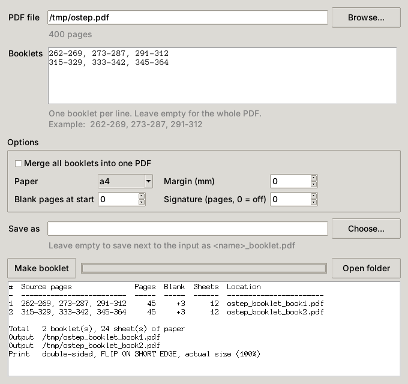

# bookletize

[](https://github.com/aaronwu001/bookletize/actions/workflows/ci.yml)

Turn any PDF (or just the chapters you need) into a **foldable booklet**.
Print double-sided, fold the stack in half, staple along the fold, and you get a small book that reads in the right order.

```
Original PDF                    Printed sheet (front)
┌───┐┌───┐┌───┐┌───┐           ┌─────────┬─────────┐
│ 1 ││ 2 ││ 3 ││ 4 │   ──►     │    4    │    1    │   fold here
└───┘└───┘└───┘└───┘           └─────────┴─────────┘        │
                                                            ▼
                               Printed sheet (back)       a booklet
                               ┌─────────┬─────────┐      that reads
                               │    2    │    3    │      1, 2, 3, 4
                               └─────────┴─────────┘
```

## Features

- **Page ranges**: print only the pages you need, including non-contiguous ranges (`41-51,102-114,332`).
- **Multiple booklets in one run**: each chapter (or group of chapters) becomes its own booklet, so you never fold a booklet that starts in the middle of a sheet.
- **Automatic padding**: each booklet is padded with blank pages to a multiple of 4, independently of the others.
- **Signatures** for thick booklets: split a long booklet into smaller stacks that fold flat.
- **Fast on heavy PDFs**: pages are placed as Form XObjects, so page content is never parsed or rewritten.
- Handles rotated pages, mixed page sizes, A4 / Letter / A3 paper.
- **Command line and desktop app**: use `bookletize` in a terminal, or `bookletize-gui` for a simple window.
- One dependency (`pypdf`, version 6 or 7). The GUI uses tkinter, which ships with Python.

## Installation

### Windows, no Python needed

Download `bookletize-gui.exe` from the [Releases](https://github.com/aaronwu001/bookletize/releases) page and double-click it.
Python and all dependencies are bundled inside, so nothing else needs to be installed.

- The `.exe` is not code-signed, so Windows SmartScreen may show "Windows protected your PC" the first time.
  Click **More info**, then **Run anyway**. Some antivirus programs also flag PyInstaller builds by mistake.
- It takes a few seconds to open, because the bundled Python is unpacked on every start.
- The `.exe` is Windows only. On macOS and Linux, install with pip (below).

### With pip

Requires Python 3.9+.

```bash
pip install git+https://github.com/aaronwu001/bookletize.git
```

On Windows, if `pip` is not found:

```powershell
python -m pip install git+https://github.com/aaronwu001/bookletize.git
```

This installs two commands:

| Command | What it does |
|---|---|
| `bookletize` | Command line tool |
| `bookletize-gui` | Desktop window |

If the commands are not found after installing, use `python -m bookletize` instead of `bookletize`, and `python -m bookletize.gui` instead of `bookletize-gui`.

## Desktop app

```bash
bookletize-gui
```



1. Click **Browse...** and choose a PDF.
2. In **Booklets**, write one booklet per line, for example:
   ```
   262-269, 273-287, 291-312
   315-329, 333-342, 345-364
   ```
   Leave it empty to make the whole PDF into one booklet.
3. Click **Make booklet**. The summary appears at the bottom; **Open folder** shows the result.

## Command line

### One booklet

```bash
bookletize book.pdf                  # whole PDF
bookletize book.pdf -r 5-40          # pages 5 to 40 only
bookletize book.pdf -r 1-3,10-20     # several ranges joined into one booklet
bookletize book.pdf -o my_book.pdf   # custom output name
```

The default output name is `<input>_booklet.pdf`.

### Several booklets (one per chapter)

Use one `-c` per booklet:

```bash
bookletize book.pdf -c 1-12 -c 13-30 -c 31-45
```

To put several non-contiguous ranges into the **same** booklet, separate them with commas inside one `-c`, and wrap it in quotes (required in PowerShell):

```bash
bookletize ostep.pdf -c "262-269,273-287,291-312" -c "315-329,333-342,345-364"
```

This produces two booklets, each containing three ranges.

File names with spaces also need quotes:

```bash
bookletize "Think Faster, Talk Smarter.pdf" -r 92-110
```

You can also pass several PDF files; each file becomes its own booklet:

```bash
bookletize ch1.pdf ch2.pdf ch3.pdf
```

**Output files**

- By default, each booklet is written to its own file:
  `book_booklet_book1.pdf`, `book_booklet_book2.pdf`, ...
- Add `--merge` to put every booklet into one PDF so you can print everything at once:

  ```bash
  bookletize book.pdf -c 1-12 -c 13-30 -c 31-45 --merge
  ```

  Every booklet still starts on a fresh sheet of paper and is padded separately.
  Use the **Location** column of the summary to split the printed stack.

### Summary output

After each run, a summary table is printed:

```
#  Source pages               Pages  Blank  Sheets  Location
-  -------------------------  -----  -----  ------  -----------------------
1  262-269, 273-287, 291-312     45     +3      12  ostep_booklet_book1.pdf
2  315-329, 333-342, 345-364     45     +3      12  ostep_booklet_book2.pdf

Total   2 booklet(s), 24 sheet(s) of paper
Output  ostep_booklet_book1.pdf
Output  ostep_booklet_book2.pdf
Print   double-sided, FLIP ON SHORT EDGE, actual size (100%)
```

| Column | Meaning |
|---|---|
| Source pages | Pages of the original PDF used in this booklet |
| Pages | Number of content pages |
| Blank | Blank pages added to reach a multiple of 4 |
| Sheets | Sheets of paper this booklet uses |
| Stacks | Number of signatures (shown only with `-s`) |
| Location | Output file name, or the sheet numbers inside the merged file when using `--merge` |

## Options

| Option | Description |
|---|---|
| `-r RANGE` | Pages for a single booklet, e.g. `5-40` or `1-3,10-20` |
| `-c RANGE` | Pages for one booklet; repeat for each booklet. Cannot be combined with `-r` |
| `--merge` | Write all booklets into one PDF (default: one PDF per booklet) |
| `-s N` | Signatures: split each booklet into stacks of N pages (N must be a multiple of 4) |
| `--blank-start N` | Insert N blank pages at the front of each booklet |
| `-o FILE` | Output file name |
| `--paper` | `a4` (default), `letter`, or `a3` |
| `--margin MM` | Margin around each page, in millimetres |
| `-V` | Show the version |

**Range syntax**

| Example | Meaning |
|---|---|
| `5-40` | Pages 5 to 40 |
| `7` | Page 7 only |
| `10-` | Page 10 to the end |
| `1-3,7` | Pages 1 to 3, plus page 7 |

## Printing

1. Print **double-sided**.
2. Choose **Flip on short edge**.
3. Set scaling to **Actual size / 100%** (not "Fit").

Then keep the sheets in order, fold the whole stack in half, and staple along the fold (saddle stitch).

## How it works

A sheet folded in half holds 4 pages, so each booklet is first padded to `n` pages, where `n` is a multiple of 4.

For sheet `k` (0-based), the pages are placed as follows (0-based page indices):

| Side | Left | Right |
|---|---|---|
| Front | `n-1-2k` | `2k` |
| Back | `2k+1` | `n-2-2k` |

Example with 8 pages (1-based):

| Sheet | Front | Back |
|---|---|---|
| 1 | 8, 1 | 2, 7 |
| 2 | 6, 3 | 4, 5 |

Each source page is wrapped as a PDF Form XObject and drawn onto a landscape sheet with a single transformation matrix (scale, center, and undo any `/Rotate`).
Because the page's drawing commands are copied as raw bytes instead of being parsed, the speed does not depend on how complex the pages are.

## FAQ

**Why are there blank pages?**
A folded sheet holds 4 pages, so each booklet is padded to a multiple of 4. Blank pages are added at the end of each booklet.

**The booklet is too thick to fold.**
Above roughly 10 sheets (40 pages), a single fold gets bulky and the inner pages stick out.
Either split at a chapter boundary with several `-c` options, or use signatures:

```bash
bookletize book.pdf -s 16
```

Note that `-s` splits by page count, so it may cut in the middle of a chapter. Splitting with `-c` lets you choose where the cut happens.

**I want a blank page after the cover.**

```bash
bookletize book.pdf --blank-start 1
```

**The printed pages are in the wrong order.**
The printer is probably set to "Flip on long edge". Switch to **Flip on short edge** and print again.

## Use it from Python

```python
from bookletize import make_booklets, format_summary

result = make_booklets(["ostep.pdf"], booklets=["262-269,273-287", "315-329"])
print(format_summary(result))
```

## Development

```bash
git clone https://github.com/aaronwu001/bookletize.git
cd bookletize
pip install -e ".[dev]"
pytest
```

Project layout:

```
src/bookletize/
  core.py      page ordering and PDF placement (shared logic)
  cli.py       command line interface
  gui.py       tkinter desktop window
tests/         pytest suite
scripts/       PyInstaller entry points for the Windows .exe
```

Releases: push a tag like `v1.0.0`; GitHub Actions builds the wheel and the Windows `.exe` files and attaches them to a GitHub Release.

## License

MIT, see [LICENSE](LICENSE).
